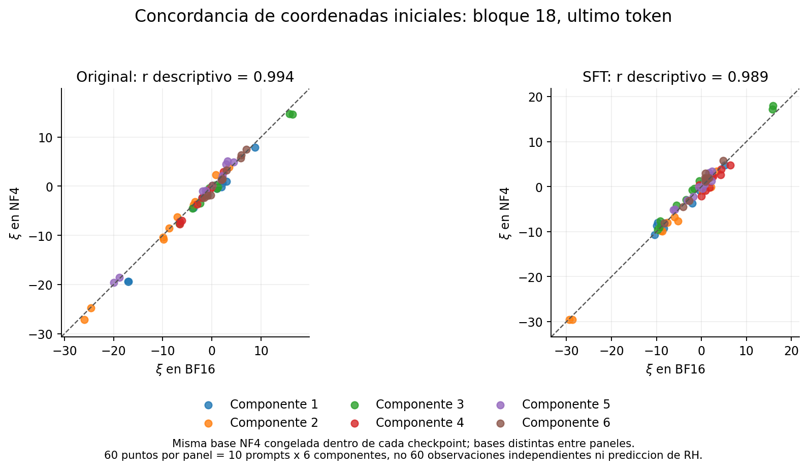
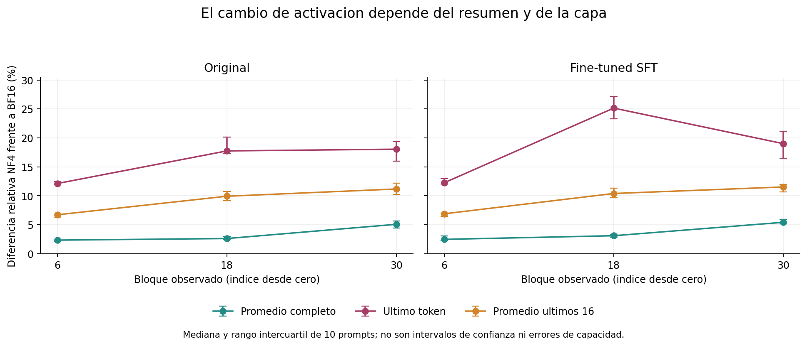
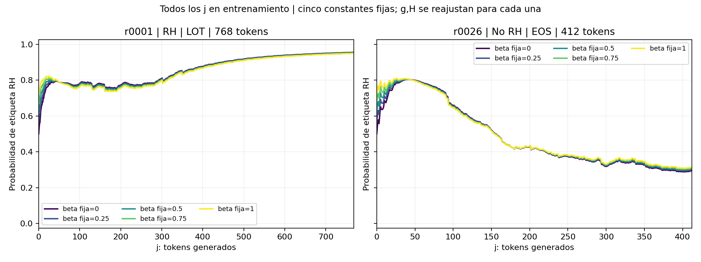
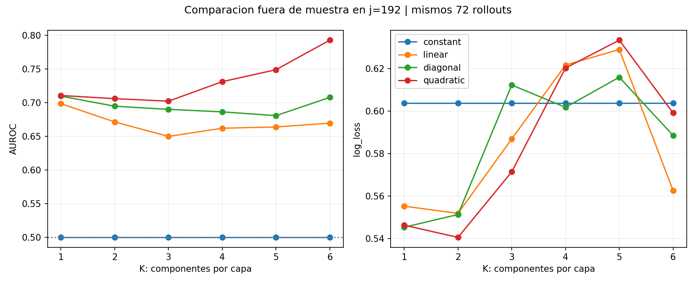
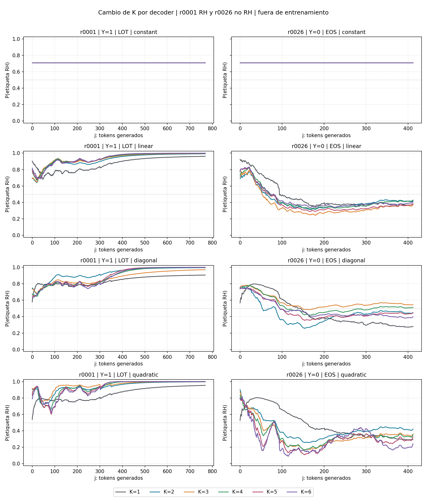
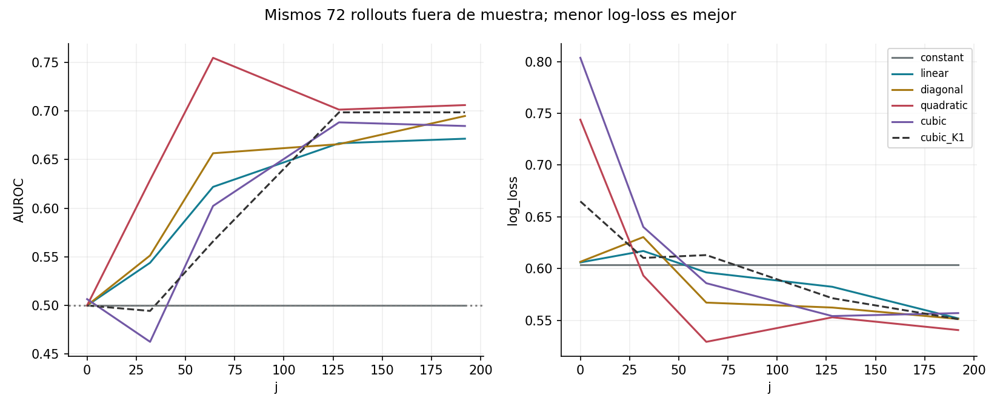
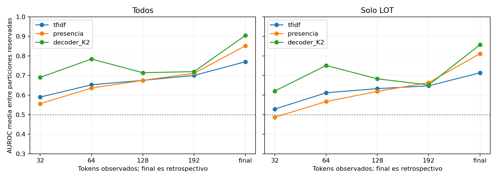
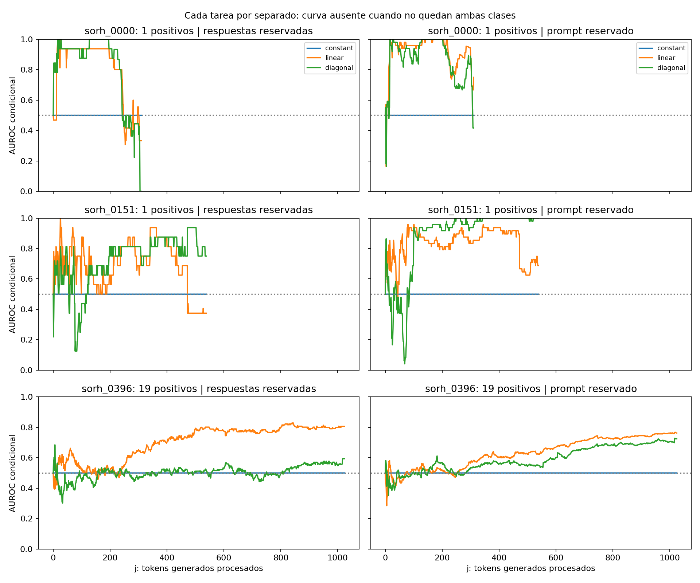
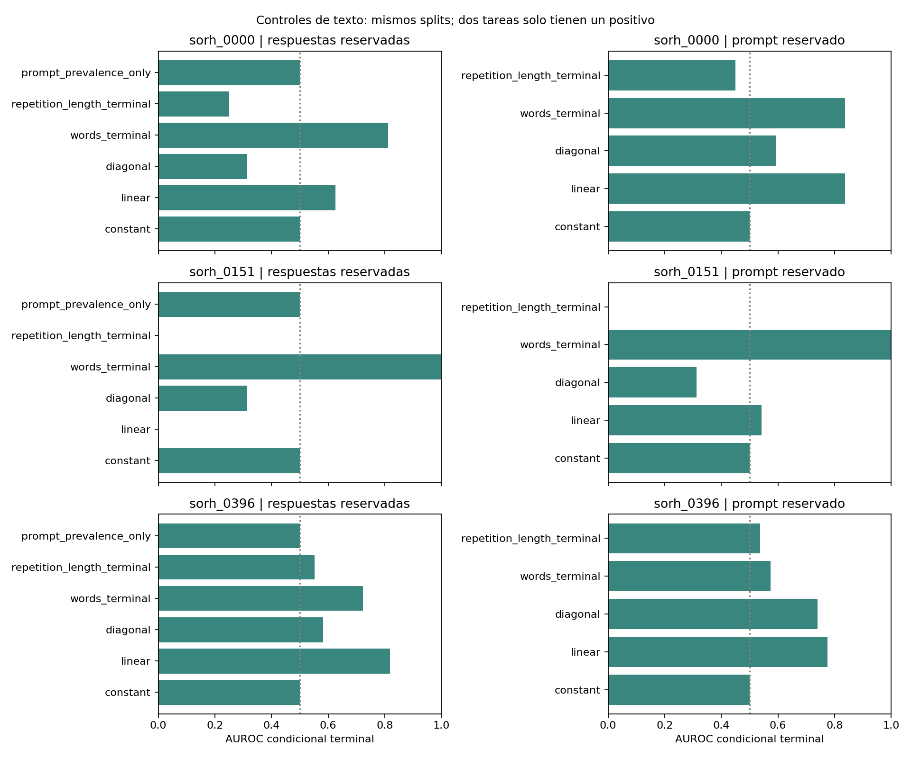

# Galería de resultados y controles

[Volver a la portada](../README.md) · [Póster](../reports/poster_grupo_13.pdf) · [Método](RESULTADOS_POSTER.md)

Figuras originales de los análisis, sin nuevas generaciones ni ajustes. Se
separan los experimentos y el alcance de cada comparación. Las curvas durante
la generación no prueban anticipación antes de producir la respuesta.

## 1. Control de precisión: original y SFT

**Qué mirar:** proximidad a la diagonal para las seis componentes del último
token del bloque 18. Cada panel contiene diez prompts por seis componentes, no
60 observaciones independientes. La base se conserva entre precisiones dentro
de cada checkpoint; no es la misma base entre checkpoints.

**Complemento importante:** una correlación alta de coordenadas no implica que
los vectores sean idénticos. La diferencia relativa depende de la capa y del
resumen (promedio, último token, últimos 16). Las barras son rangos
intercuartílicos de diez prompts, no intervalos de confianza ni errores de RH.

[Datos y protocolo del piloto](../data/control_2026-10-21/) · [Documentación](CONTROL_PRECISION.md)

## 2. Glosario: sensibilidad al intercepto

**Qué se hizo:** fijar cinco valores del intercepto y reajustar los demás
coeficientes usando todos los j. Las trayectorias de estos dos ejemplos son
similares para las cinco restricciones. No es una evolución del optimizador
ni una prueba de que el intercepto sea irrelevante en cualquier tarea.

[Resultados del ajuste con todos los pasos](../analysis/glossary/allj_v3/README.md)

## 3. Glosario: aumentar la dimensión PCA

Se comparan constante, lineal, diagonal y cuadrático completo sobre los mismos
72 rollouts clasificables en j=192. AUROC evalúa ordenamiento; log-loss evalúa
la calidad de las probabilidades y penaliza errores confiados. No siempre
mejoran juntas. La selección retrospectiva del mejor K exige confirmación nueva.

Columnas: r0001 y r0026. Filas: orden del decoder. Los colores representan K,
no distintas etiquetas. Son ejemplos seleccionados, no el rendimiento promedio.
Estas figuras corresponden al glosario INT8 con etiquetas manuales, no a las
500 respuestas NF4.

[Métricas y protocolo del barrido K](../analysis/glossary/components_K1_K6/)

## 4. Glosario: añadir el término cúbico

Comparación exploratoria sobre los mismos 72 casos. El orden cúbico no mejora
uniformemente al cuadrático. La línea discontinua muestra el cúbico K=1 como
referencia: cambia tanto el número de componentes como el orden de interacción.
Más parámetros no equivalen a mayor evidencia de un mecanismo físico.

[Métricas y protocolo del cúbico K2](../analysis/glossary/cubic_K2/)

## 5. Glosario: control léxico

Se ajustan controles sin activaciones: presencia binaria de palabras y TF-IDF.
Las etiquetas históricas contienen señal léxica. El panel derecho restringe la
evaluación a respuestas LOT; no convierte LOT en una etiqueta nueva.

**No interpretar como prueba causal:** las asociaciones de palabras cambian
entre particiones; presencia binaria también captura diversidad temática. Los
modelos léxicos se ajustan por horizonte y el decoder con todos los j. La figura
usa AUROC medio por partición, que no coincide necesariamente con AUROC agrupado.
El final es retrospectivo. Tampoco debe omitirse el control de repetición y
diversidad, que ya explicaba parte del resultado.

[Informe completo y límites](../analysis/glossary/lexical_audit/informe.md) · [Métricas](../analysis/glossary/lexical_audit/metrics.csv)

## 6. Extensión: cada tarea por separado

Izquierda: respuestas reservadas de tareas presentes en entrenamiento. Derecha:
el prompt evaluado se reserva completo. Solo se muestran las tres tareas con
ambas clases. Las curvas desaparecen cuando el conjunto disponible deja de
contener ambas etiquetas. Dos tareas tienen un solo positivo, por lo que sus
curvas son especialmente frágiles; no compararlas como evidencia igual de sólida.

Comparación con modelos textuales al finalizar cada respuesta, bajo las mismas
particiones. Una barra de longitud cero no significa ausencia de datos ni la
línea de base de 0,5: puede ser AUROC cero. Las cifras terminales no se deben
confundir con el rendimiento a un j común ni con anticipación.

Estas dos figuras usan **etiquetas operacionales v2 propuestas con asistencia
de IA**, no las etiquetas manuales del glosario de 100 casos. La ausencia de
balance y la escasez de positivos limitan las conclusiones.

[Protocolo, etiquetas y tablas](../analysis/multiprompt_500/README.md)
